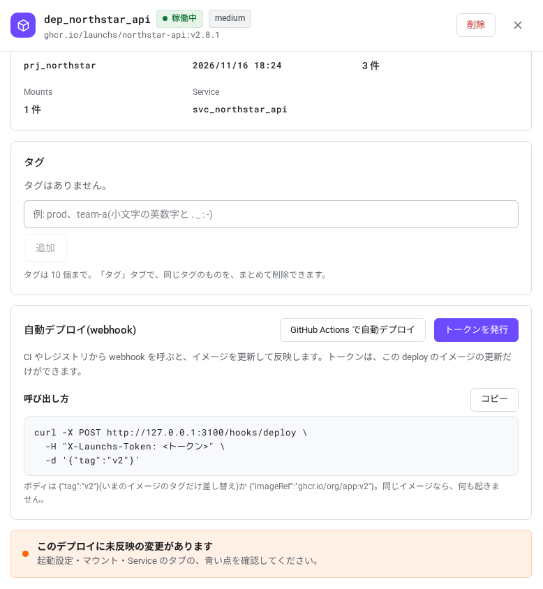

## 全体の流れ

:::steps
1. **push**

   コードを GitHub に push します。

2. **CI(テスト・ビルド)**

   CI が、テストをして、イメージを作り、レジストリ(例: ghcr.io)に置きます。タグは**毎回違うもの**(コミットの ID など)にします。

3. **CD(入れ替え)**

   CI が、launchs の webhook(`POST /hooks/deploy`)を呼ぶと、デプロイのイメージが入れ替わります。
:::

## 手順

:::steps
1. **最初のデプロイを作る**




   [最初にデプロイする方法](first-deploy.md)で、動かしておきます。

2. **トークンを発行する**

   デプロイの [[概要]] → [[自動デプロイ(webhook)]] → [[トークンを発行]]。このデプロイの、イメージ更新だけができるトークンです。

3. **CI に登録する**

   トークンを、CI のシークレットに入れます。

4. **CI から呼ぶ**
:::

```
- name: launchs に反映
  run: |
    curl -fsS -X POST "${{ secrets.LAUNCHS_URL }}/hooks/deploy" \
      -H "X-Launchs-Token: ${{ secrets.LAUNCHS_TOKEN }}" \
      -d "{\"tag\":\"${{ github.sha }}\"}"
```

GitHub Actions なら、YAML を画面が作ります([GitHub との連携](github.md))。

## 安心のしくみ

- **同じイメージなら、何も起きません**(何度呼んでも安全)。
- **反映中は `409`**。少し待って、やり直します。
- **失敗しても、元のイメージで動き続けます。**
- タグが `latest` のままだと、「変わった」と判断できません。

## 確認と、元に戻す

- デプロイの [[概要]] の「イメージ」で、更新の履歴(成功も失敗も)を見られます。
- 戻したいときは、前のタグで、もう一度 webhook を呼びます。
- 入れ替えの様子は、[メトリクス](metrics.md)(再起動の回数)と[ログ](monitoring.md#logs)で見ます。

トークンの種類、API の一覧、反映の完了を待つ方法は [API と自動デプロイ](api.md)。
