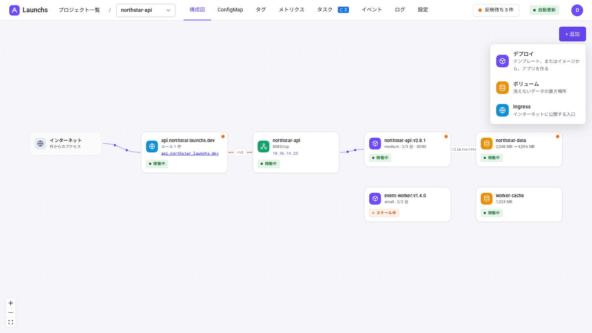
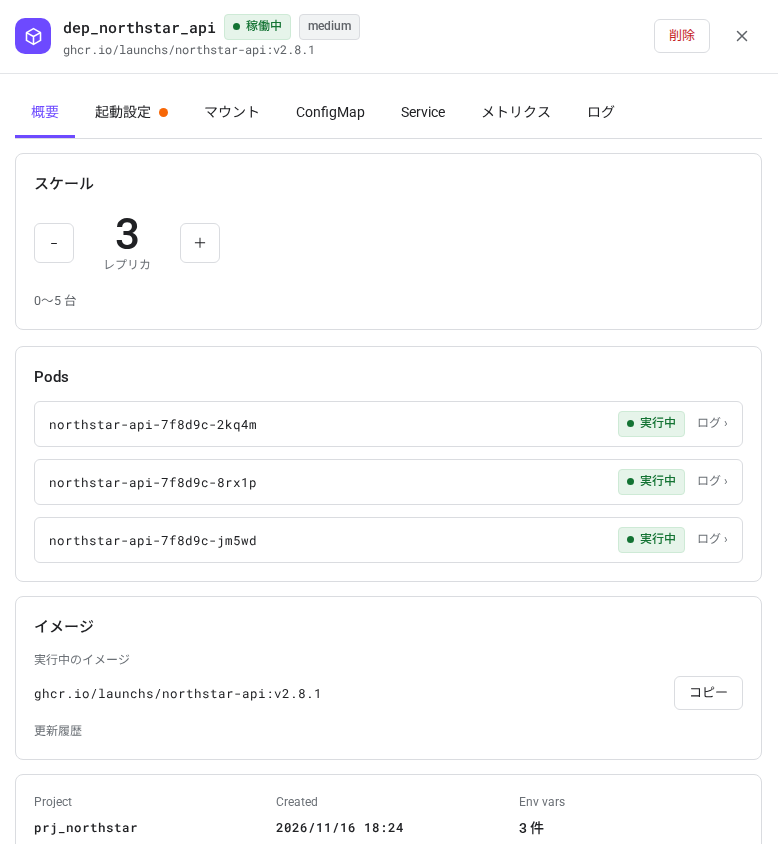
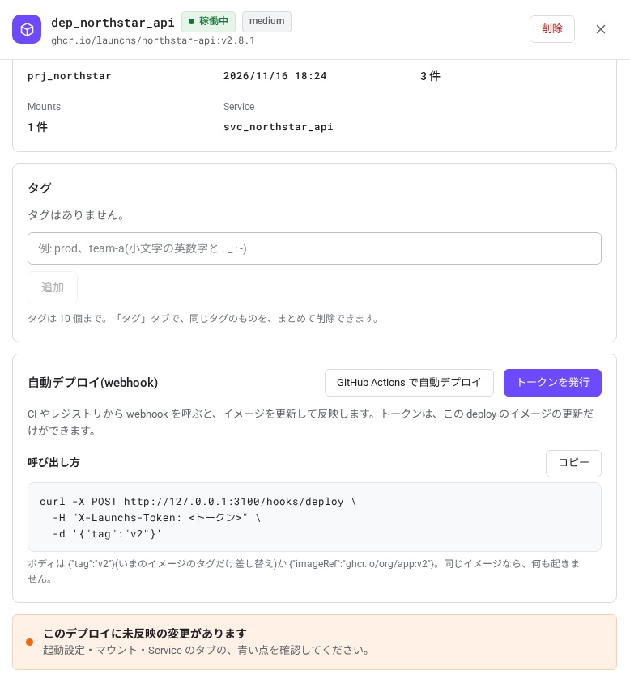

## アプリを作る

方法は 2 つです。

- **はじめてのデプロイ** — プロジェクトが空のとき、画面から案内されます([はじめてのガイド](start.md))。
- **[[+ 追加]] → [[デプロイ]]** — 構成図の右上から、いつでも追加できます。**テンプレート**(ひな形)か、**イメージ**(アプリの名前)を選びます。

:::note warn 使えるイメージ
誰でも取れる、**公開されたイメージ**が使えます(例: `nginx:latest`、`ghcr.io/ユーザー/アプリ:1.0`)。**非公開のイメージ**(パスワードが必要なもの)は、まだ使えません。
:::

## スペック(アプリの大きさ) {#spec}

アプリが使える、計算の力(CPU)と、記憶の量(メモリ)です。**作るときに選んで、あとから変えられません**。大きくしたいときは、大きなスペックで、作り直します。

| スペック | CPU | メモリ | 向いているもの |
|---|---|---|---|
| **small** | 0.25 コア | 256 MiB | 簡単なホームページ、小さなツール。**迷ったら、これ**。 |
| **medium** | 0.5 コア | 512 MiB | WordPress、小さなデータベースなど。 |
| **large** | 1 コア | 1 GiB | 重めの処理をするアプリ。 |

:::note info 数の上限
スペックごとに、動かせる数に上限があります(初期値は、small 20 個・medium 10 個・large 5 個)。[アカウントと上限](account.md)を見てください。
:::

## デプロイの画面(右のパネル)

構成図の、デプロイのカードを押すと、右にパネルが開きます。上に、6 つのタブがあります。

| タブ | できること |
|---|---|
| [[概要]] | 状態、動いている台数(Pod)、**スケール**(台数の変更)。 |
| [[起動設定]] | **環境変数**、**Command**、**Args** を変える。 |
| [[マウント]] | **ボリューム**(消えないデータの置き場所)を、アプリの中のどこに置くか決める。 |
| [[ConfigMap]] | **設定ファイル**を、アプリの中のどこに置くか決める。 |
| [[Service]] | アプリが待ち受ける、**ポート**(窓口の番号)を決める。公開のために、必要です。 |
| [[ログ]] | アプリが出した、メッセージを見る。 |

## 台数を増やす・減らす(スケール)

:::steps
1. **[[概要]]タブの「スケール」を開く**

   [[＋]] / [[－]] で、台数(レプリカ)を変えます。**0〜5 台**です。

2. **反映する**

   ボタンの案内にしたがって、変更を反映します。台数が 0 のときは、アプリが**止まっています**(消えるわけではありません。もう一度、増やせば、動きます)。
:::

:::note tip 台数を増やすと
たくさんのお客さんを、同時にさばけます。1 台が不調になっても、ほかの台が動き続けるので、安心です。ただし、**データを 1 つの場所にしか置けないアプリ**(データベースなど)は、台数 1 のままにしておきましょう。
:::

## 環境変数や起動のしかたを変える

[[起動設定]]タブで、次を変えられます。

- **環境変数** — アプリに渡す、設定の値(例: `MODE=production`)。[[追加]]で行を足して、**名前(キー)**と**値**を入れます。同じ名前は、2 回使えません。
- **Command / Args** — アプリの起動のしかたを、上書きします。**分からなければ、空のまま**で大丈夫です。

:::steps
1. **保存する**

   変更したら、[[保存]]。まだ、動いているアプリは変わりません。

2. **反映する**

   「起動設定に未反映の変更があります」と出たら、内容を確認して、[[反映]]。**アプリが作り直されます**(短い間、つながらなくなることがあります)。
:::

:::note warn パスワードなどの秘密
環境変数の値は、画面で見えます。ほかの人と共有するプロジェクトでは、重要な秘密を入れるのは、避けてください。
:::

## アプリを消す

デプロイのパネルの [[削除]] を押して、確認します。**元に戻せません**。そのデプロイの Service も、いっしょに消えます。ボリュームは、別のものなので、残ります(中のデータも、そのままです)。

## うまく動かないとき、自動で起こること

- **作ったのに、5 分たっても起動しない** → 作成は**失敗**になり、作ったものは、片づけられます(状態は [[bad:failed]])。イメージ名の間違い、ポートの間違い、大きさ不足が、よくある原因です。
- **動いていたアプリが、落ちては立ち上がる、をくり返す(10 分以上)** → 自動で**台数が 0 になって、止まります**。原因を直してから、台数を戻します。

原因の探し方は、[様子を見る](monitoring.md)と、[困ったとき](faq.md)にあります。
