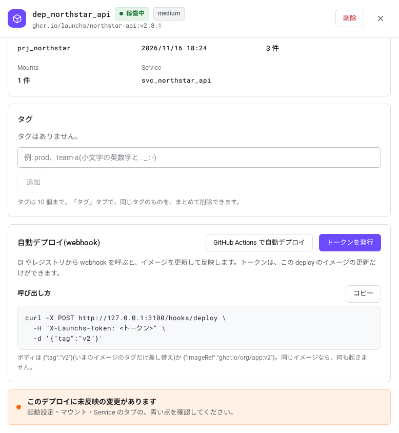
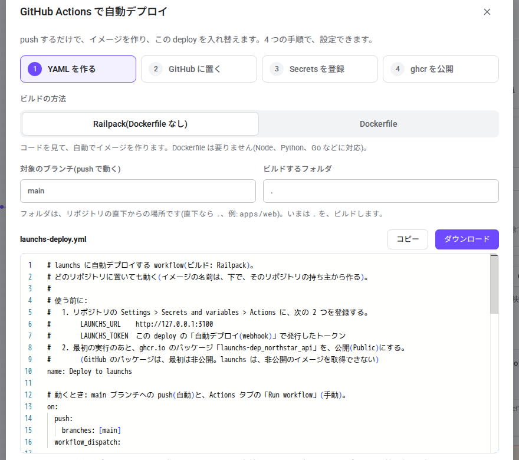

## しくみ

launchs は、GitHub のコードを直接は読みません。**GitHub Actions** が、①コードからイメージを作り、②ghcr.io に置き、③launchs に「入れ替えて」と伝えます。その YAML を、画面が作ってくれます。

## 設定の 4 ステップ

デプロイの [[概要]] → [[自動デプロイ(webhook)]] → [[GitHub Actions で自動デプロイ]]。

:::steps
1. **YAML を作る**

   ビルドの方法(**Railpack**=Dockerfile なし、または **Dockerfile**)、対象のブランチ、ビルドするフォルダ(直下なら `.`)を選んで、YAML を作ります。

2. **GitHub に置く**

   リポジトリの `.github/workflows/launchs-deploy.yml` として、置きます(画面に、GitHub の操作の絵つきの案内があります)。

3. **Secrets を登録**

   GitHub の **Settings → Secrets and variables → Actions** に、`LAUNCHS_URL` と `LAUNCHS_TOKEN` を入れます(値は画面からコピー)。

4. **ghcr を公開**

   最初の実行のあと、パッケージを **Public** にします。非公開のイメージは、まだ取得できません。
:::

## そのあと

- 対象のブランチへの **push で、自動**で動きます。**Actions** タブの [[Run workflow]] で、手動でも動かせます。
- 反映の様子は、[[タスク]]と、デプロイの[[イメージの履歴]]で見られます。

:::note warn つまずきやすいところ
- ghcr のパッケージが非公開 → 取得に失敗します。Public にして、もう一度 push します。
- Organization のパッケージが公開にできない → Organization の **Settings → Packages** で、公開を許可します。
- トークンは、YAML に書かず、**Secrets** に入れます。漏れたら、失効して、発行し直します。
:::

仕組みの詳細と API は [CI/CD をする方法](cicd.md)、[API と自動デプロイ](api.md)。
