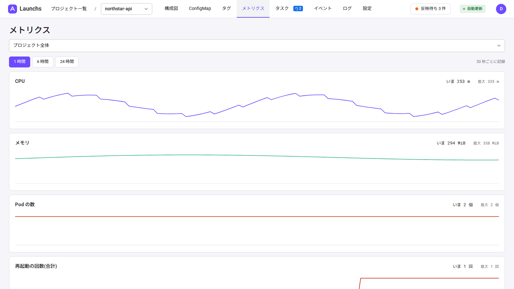
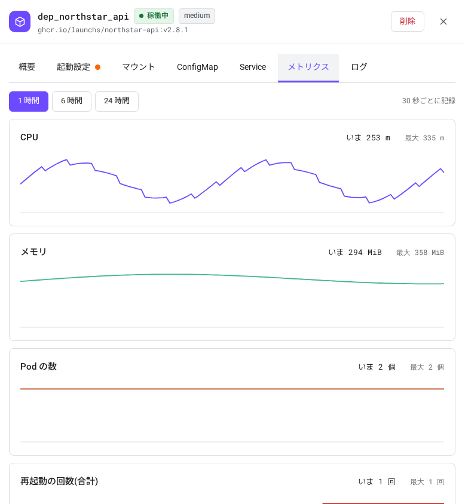

## ひとことで言うと

メトリクスは、アプリの**健康診断の数字**です。重くなっていないか、落ちて再起動していないかを、グラフで見られます。

## 見られる数字

| 項目 | 意味 |
|---|---|
| CPU | 計算の力の使用量。`m`(ミリコア)で、1000m = 1 コア。small のスペックは 250m が上限の目安です。 |
| メモリ | 記憶の使用量。スペックの上限に近づいたら、大きなスペックを考えます。 |
| Pod の数 / Ready の数 | 動いている台数と、受付できる状態の台数。 |
| 再起動 | コンテナが落ちて、立ち上がり直した回数。**増え続けていたら、アプリに問題があります**。 |

## 見かた

- **プロジェクトの [[メトリクス]] タブ** — 「見る範囲」を選びます: プロジェクト全体、**タグ**ごと、**デプロイ** 1 つ。
- **デプロイのパネルの [[メトリクス]] タブ** — そのデプロイだけ。
- 期間は **1 時間 / 6 時間 / 24 時間**。自動で更新されます。

## 知っておくこと

- 30 秒ごとに記録して、**24 時間分**を残します。
- CPU とメモリは、クラスターの metrics-server から取ります。無いときは、「CPU とメモリは記録されていません」と出て、Pod の数と再起動だけが出ます。
- デプロイを消すと、その記録も消えます。
- メッセージの中身を見るときは、[ログ](monitoring.md#logs)へ。
