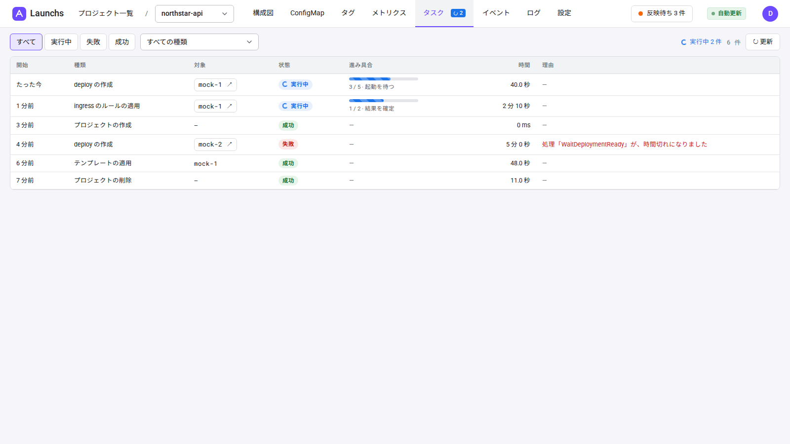
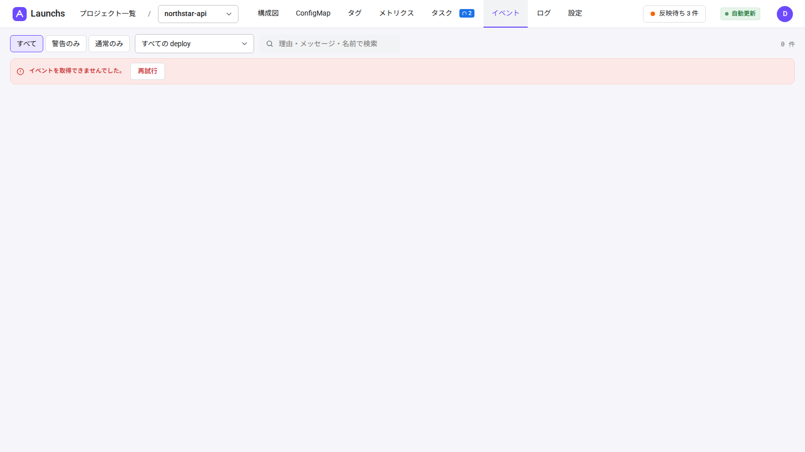
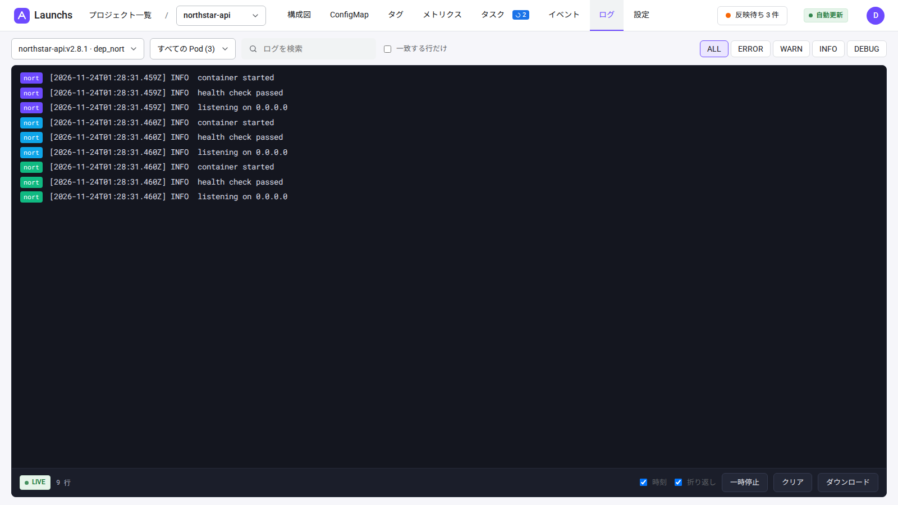
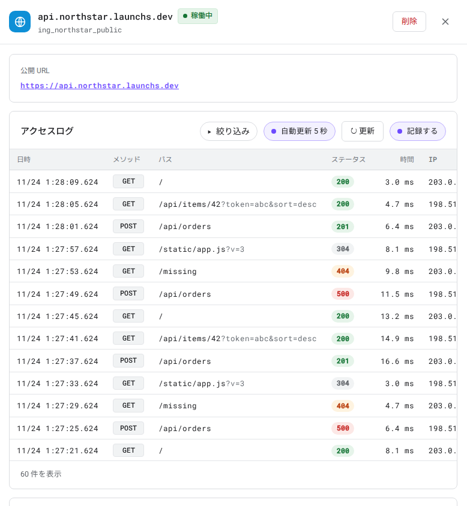

## どこを見ればいい?

| 知りたいこと | 見る場所 |
|---|---|
| 操作したのに、**変更が入った?** 失敗した? いま、どこまで進んだ? | [タスク](#tasks) |
| アプリが**起動しない**、画像が取れない、メモリが足りない | [イベント](#events) |
| アプリが**出したメッセージ**(エラーの文など)を読みたい | [ログ](#logs) |
| **誰が、いつ、どこを**開いたか | [アクセスログ](#access) |

## タスク — 裏で動いた処理の履歴 {#tasks}

「アプリを作る」「公開のルールを反映する」「プロジェクトを消す」など、**launchs が裏で行った処理**を、新しい順に、表で見られます。プロジェクトの [[タスク]] タブと、**プロジェクトの一覧の画面の下**(全部のプロジェクト分。**消したプロジェクトの記録も、残ります**)にあります。

- **状態** — [[run:実行中]](回転マークが回ります)、[[ok:成功]]、[[bad:失敗]]、[[mut:不明]](終わりの記録が付かなかったもの)。
- **進み具合** — 実行中は、**進行バー**と、いま動いている手順(例: 「起動を待つ」)が出ます。数秒ごとに、自動で更新されます。
- **行を押すと** — **手順の一覧**が開きます。終わった手順は**緑のチェック**、動いている手順は**回転マーク**(やり直し中なら「2 回目の試行」)、失敗は**赤**、これからの手順は**白抜きの丸**です。失敗したときは、**理由**も出ます。
- **絞り込み** — 状態(実行中・失敗・成功)と、種類(アプリの作成、公開の反映、など)で、絞れます。

:::note tip 失敗したら、まずここ
失敗の理由が、短く出ます。それだけで分からなければ、次の「イベント」と「ログ」に、進みます。
:::

## イベント — 動かす途中の「できごと」 {#events}

アプリを動かす土台(Kubernetes)が、記録した、**できごと**です。「イメージを取得できなかった」「置く場所がなかった」「起動に失敗した」のように、**起動しない原因の、手がかり**が見つかります。プロジェクトの [[イベント]] タブです。

- **警告**は、目立つ色で出ます。よくある理由には、**短い説明と、次にすること**が付きます。
- **警告のみ / 通常のみ**、**デプロイ**、**キーワード**で、絞れます。
- タブに出る**数字**は、直近 1 時間の警告の数です。

## ログ — アプリが出したメッセージ {#logs}

アプリが、自分で出した、**メッセージの記録**(エラーの文、動いた記録など)です。デプロイのパネルの [[ログ]] タブと、プロジェクトの [[ログ]] タブで、見られます。

- 数秒ごとに、続きが、読み込まれます。
- 保存期間は **7 日**です。アプリごとに、約 **50 MB** まで(超えると、古い行から消えます)。
- アプリが作り直されても、**前の台のログも、残っています**。

## アクセスログ — 誰が、いつ、どこを開いたか {#access}

公開した URL への、**アクセスの記録**です。**1 回ずつ**、1 行で、表に出ます。Ingress のカードを押して、右のパネルの [[アクセスログ]] で、見ます。

| 列 | 意味 |
|---|---|
| 日時 | アクセスがあった時刻(ミリ秒まで)。 |
| メソッド | GET(見る)、POST(送る)など、アクセスの種類。 |
| パス | 開かれた URL の、後ろの部分(`?` 以降の、パラメータも含みます)。 |
| ステータス | 結果の番号。[[ok:2xx]] 成功、[[mut:3xx]] 転送、[[warn:4xx]] 見つからない・禁止など(お客さん側の問題)、[[bad:5xx]] アプリ側のエラー。 |
| 時間 | 返事までに、かかった時間。 |
| IP | アクセスした人の、ネットワーク上の住所。 |
| サイズ | 返したデータの大きさ。 |

- **絞り込み** — [[絞り込み]]を押すと、**開始・終了の日時**、**パス**、**IP**、**ステータス**、**メソッド**の欄が出ます(閉じることもできます)。
- **更新** — [[↻ 更新]]で、最新に。[[自動更新 5 秒]]を入れておくと、自動で、新しいものが出ます。
- **記録する** — オフにすると、**新しいアクセスを、記録しません**(過去の分は、保存期間のあいだ、見られます)。

:::note warn プライバシーに注意
パス(URL)は、**?以降のパラメータも含めて、そのまま**記録されます。`?token=…` のような**秘密の値が URL に入るアプリ**では、その値も、ログに残ります。IP アドレスも、記録されます。
:::

- 保存は、最大 **24 時間**、または、1 つの Ingress あたり **5000 件**(どちらか早い方)です。
- 記録されるのは、**記録を有効にしたあとの**アクセスだけです。
