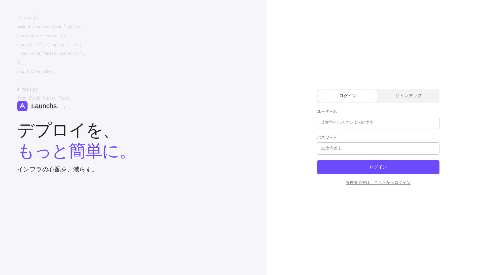
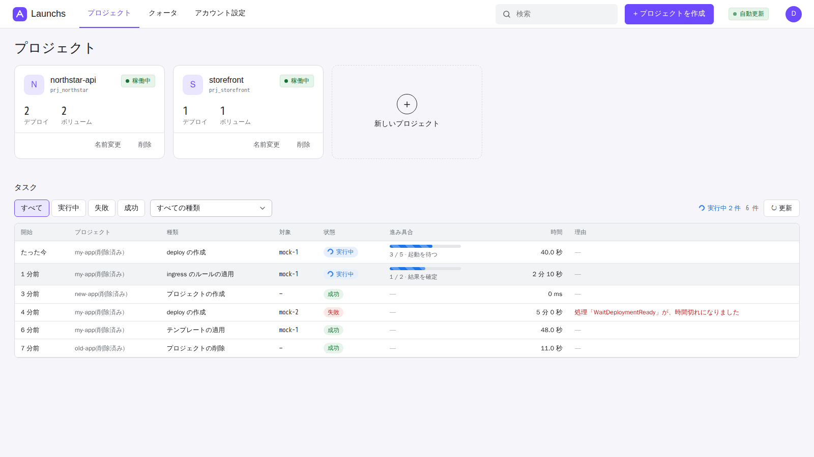
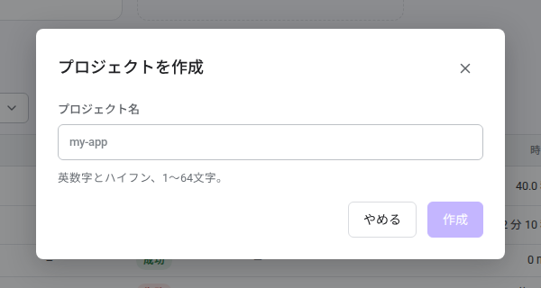
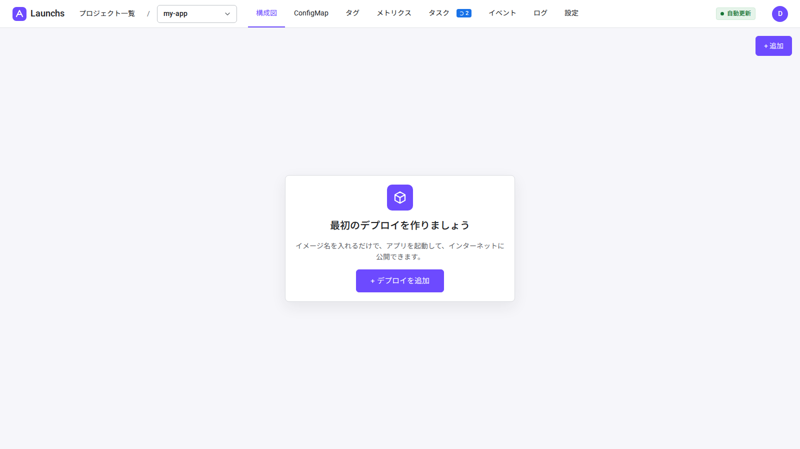
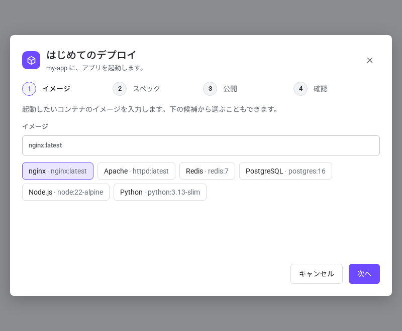
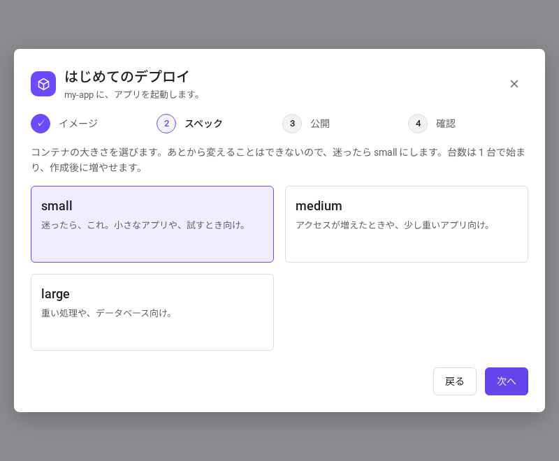
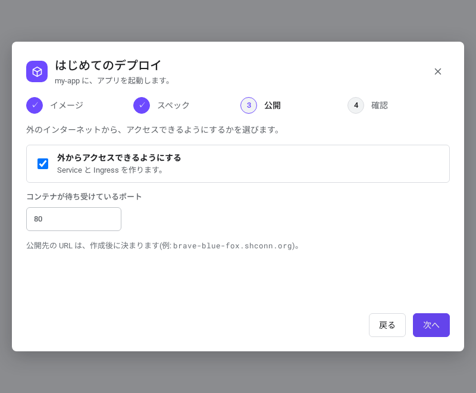
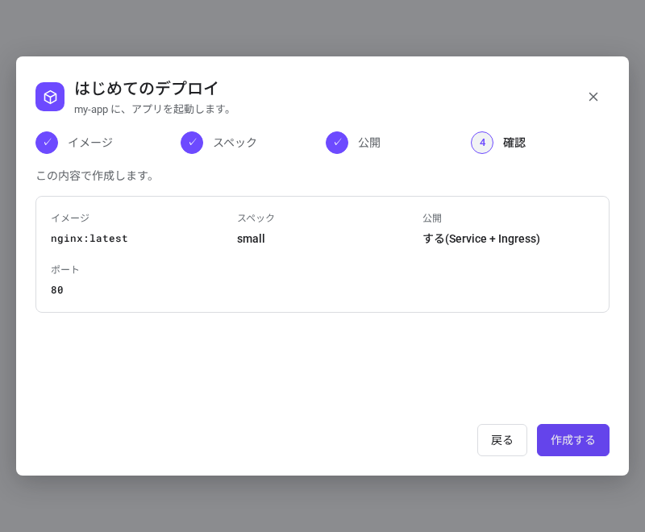
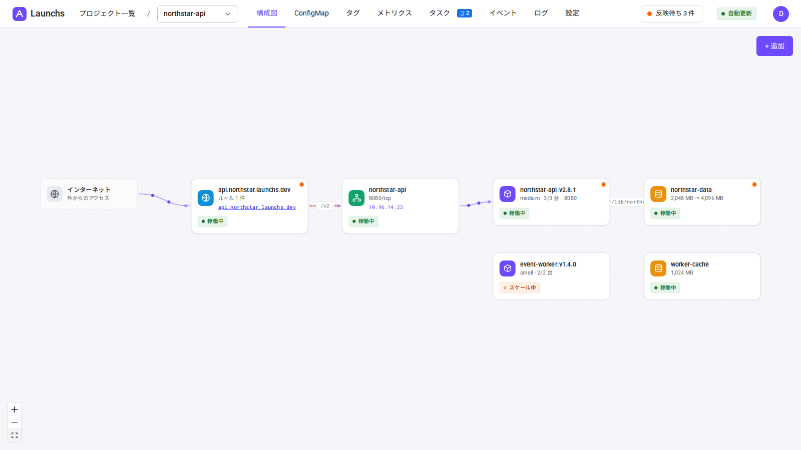

## 始める前に、用意するもの

- **サイトの URL** — 管理者から教えてもらいます。
- **招待コード** — 招待制のサイトでは、必要です。管理者に頼んでください(使えるのは 1 回だけで、期限があります)。
- **動かしたいアプリ** — 迷ったら、`nginx:latest`(簡単なホームページを出すアプリ)で、試せます。

## 手順

:::steps
1. **アカウントを作る(サインアップ)**

   サイトを開くと、ログインの画面が出ます。[[サインアップ]](新規登録)に切り替えて、次を入れます。

   

   - **ユーザー名** — 自分で決めます。
   - **パスワード** — **12 文字以上**。ありがちなパスワード(`password1234` など)や、漏れたことのあるパスワードは、使えません。
   - **招待コード** — 招待制のサイトだけ、入力欄が出ます。
   - 「人間であることの確認」の表示が出たら、チェックを入れます。

   ::::note warn パスワードを忘れないで
   パスワードを自分で再設定する機能は、まだありません。パスワードは、安全な場所に控えておいてください。
   ::::

2. **ログインする**

   作ったユーザー名とパスワードで、ログインします。**5 回続けて間違える**と、**15 分間**、そのユーザー名でログインできなくなります(焦って入れ直さず、少し待ちましょう)。

3. **プロジェクトを作る**

   「プロジェクト」は、**アプリ一式を入れる箱**です(くわしくは [しくみと言葉](concepts.md))。[[プロジェクト]]の画面で、[[作成]]を押して、名前を付けます。

   - 名前は、**英数字とハイフン**で、**1〜64 文字**(例: `my-app`)。日本語や空白は、使えません。

   

   

4. **プロジェクトを開く**

   作ったプロジェクトの名前を押します。[[構成図]]の画面が開きます。最初は、空っぽです。

   

5. **最初のアプリを動かす(はじめてのデプロイ)**

   画面の案内にしたがって、「はじめてのデプロイ」を進めます。4 つのステップです。

   | ステップ | やること |
   |---|---|
   | ① イメージ | 動かすアプリの名前(コンテナイメージ)を入れます。「よく使うイメージ」の候補から、選んでも OK。迷ったら `nginx:latest`。 |
   | ② スペック | アプリの**大きさ**を、**small / medium / large** から選びます。**あとから変えられない**ので、迷ったら **small**(くわしくは [アプリを動かす](deploy.md#spec))。 |
   | ③ 公開 | 「外からアクセスできるようにする」を選ぶと、インターネットに公開する準備(Service と Ingress)も、いっしょにしてくれます。アプリが使うポート番号は、自動で候補が出ます(`nginx` なら 80)。 |
   | ④ 確認 | 内容を見て、[[作成する]]を押します。 |

   

   

   

   

   作成には、少し時間がかかります。進み具合は、画面に出ます。終わったら、[[キャンバスを見る]]を押します。

   ::::note tip ひな形から始めたいとき
   [[+ 追加]] → [[デプロイ]] で、イメージではなく**テンプレート**(WordPress など)からも作れます。[テンプレートで一括作成](templates.md)を見てください。
   ::::

6. **公開 URL を開く**

   構成図に、**Ingress**(インターネットの入口)のカードが出ます。押すと、右に詳細が開いて、**公開 URL**(例: `https://brave-blue-fox.example.org`)が見えます。押して、開いてみましょう。

   

   ::::note info すぐ開けないとき
   URL が行き渡るまで、**数分**かかることがあります。「見つかりません」と出たら、少し待って、もう一度開いてください。
   ::::
:::

## 画面の見方

プロジェクトを開いたあとの、上のタブです。

| タブ | 見られるもの |
|---|---|
| [[構成図]] | メインの画面。アプリ、データ、公開の入口が、線でつながった図で見えます。カードを押すと、右に詳細が開きます。右上の [[+ 追加]] で、デプロイ・ボリューム・Ingress を作れます。 |
| [[ConfigMap]] | 設定ファイルの管理。 |
| [[タスク]] | 裏で動いた処理の履歴と、進み具合。 |
| [[イベント]] | 動かす途中で起きた、できごとの記録(失敗の手がかりが見つかります)。 |
| [[ログ]] | アプリが出した、メッセージの記録。 |
| [[設定]] | プロジェクトの名前の変更と、削除。 |

## 次は?

- 言葉が分からなかった → [しくみと言葉](concepts.md)
- 環境変数を足したい、台数を増やしたい → [アプリを動かす](deploy.md)
- 動かなかった → [困ったとき](faq.md)
