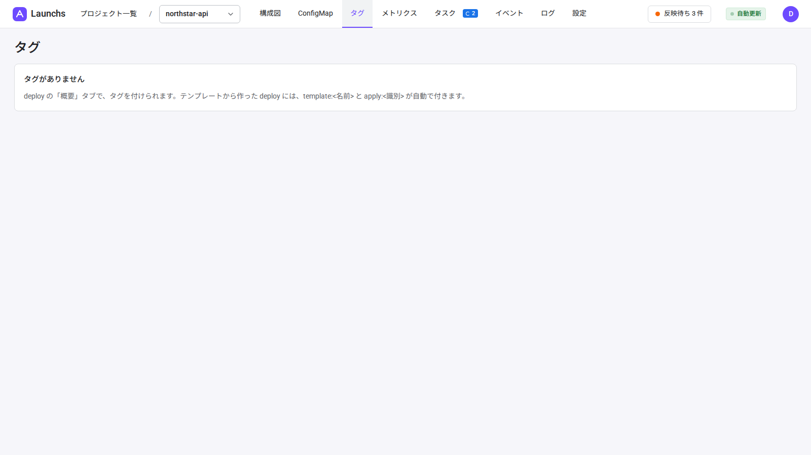

## ひとことで言うと

タグは、持ち物に貼る**付箋**です。同じ付箋を貼ったものを、**まとめて見たり、まとめて消したり**できます。(イメージの版の「タグ」とは、別のものです)

## できること

- **まとめて見る** — 画面上のタグ一覧を押すと、同じタグのカードが強調されます。
- **まとめてメトリクスを見る** — タグ単位で、CPU・メモリを合計して見られます([メトリクスとは](metrics.md))。
- **まとめて消す** — 「このタグを削除」で、タグの付いたもの全部の削除を受け付けます。順番は、Ingress → Service → デプロイ。**ボリュームと ConfigMap は、データを守るため、消しません**。

## ルール

| 項目 | 内容 |
|---|---|
| 数 | 1 つの資源に、10 個まで。 |
| 文字 | 40 文字まで。小文字の英数字で始まり、英数字と `. _ : -` が使えます。 |
| 付けられるもの | デプロイ、ボリューム、Service、Ingress(ConfigMap は不可)。 |
| 自動で付くもの | テンプレートから作ると、`template:テンプレート名` と、その 1 回分の `apply:…` が付きます。 |

:::note tip 使い方の例
`web`、`prod` のように、役割や環境で付けておくと、「`prod` の合計メモリ」のように見られます。
:::

画面は、構成図のカード、[[タグ]]タブ、各パネルの編集欄です。
