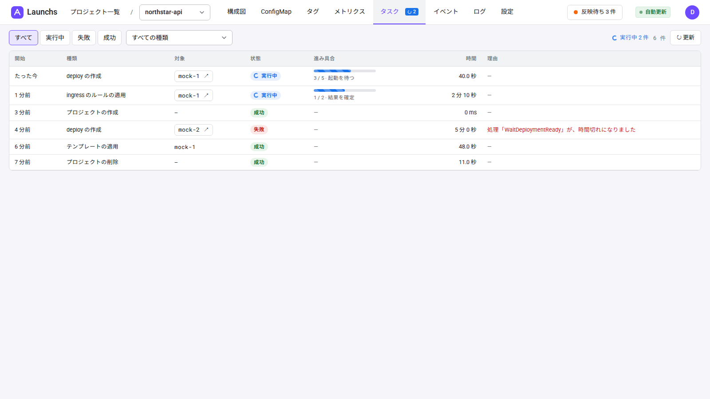

## ひとことで言うと

「アプリを作る」「公開のルールを反映する」「プロジェクトを消す」などは、画面を押したあと、**裏で、順番に処理**されます。その1つ1つがタスクで、**進み具合と結果**が残ります。

:::words
状態 :: [[run:実行中]]、[[ok:成功]]、[[bad:失敗]]、[[mut:不明]](終わりの記録が付かなかったもの)。
手順 :: タスクの中の、細かい段階。行を押すと開き、終わった手順は緑のチェック、動いている手順は回転マーク、失敗は赤で、理由も出ます。
:::

## いつ見る?

- 反映したのに、**変わらない・終わらない**とき。
- **失敗**したとき。まず、ここで**理由**を見ます。

- プロジェクトの [[タスク]] タブ(そのプロジェクトの分)と、プロジェクト一覧の下(全部の分。消したプロジェクトの記録も残る)にあります。
- 保存は **30 日**、または、プロジェクトごとに **1000 件**まで。

理由が分からないときは、イベントとログへ。[様子を見る](monitoring.md)。
