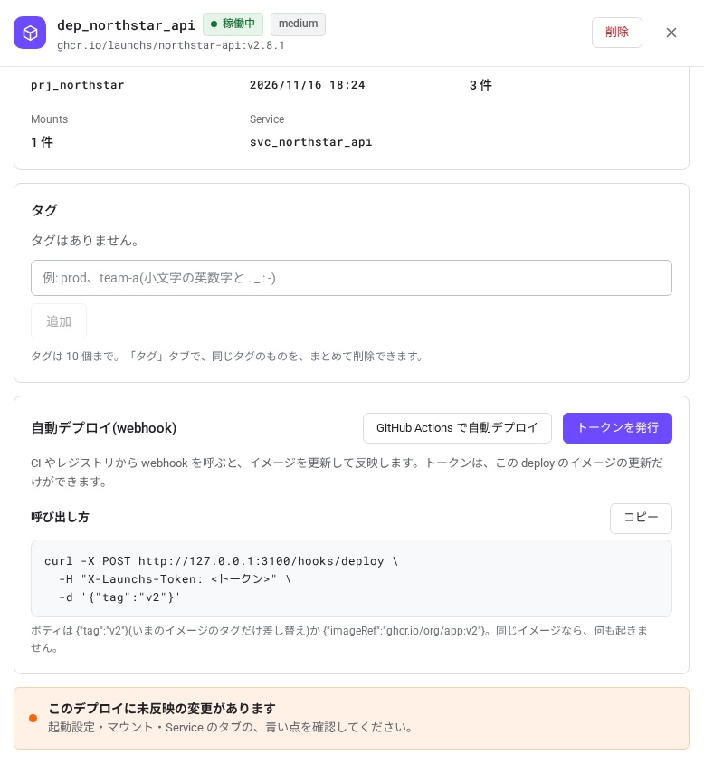

## ひとことで言うと

ボリュームは、アプリの外に置く、**貸し倉庫**のようなものです。アプリ(部屋)を作り直しても、倉庫の中身は、そのまま残ります。

| 置くもの | ボリューム |
|---|---|
| データベースの中身、アップロードされた画像、アプリが書き出したファイル | 要る(置かないと、作り直しで消える) |
| アプリ本体、一時的なファイル | 要らない |

## 使うまでの流れ

:::steps
1. **ボリュームを作る**

   [[+ 追加]] → [[ボリューム]]。名前と、大きさ(MB)を決めます。

2. **アプリにつなぐ(マウント)**

   デプロイの [[マウント]] タブで、「アプリの中の、どのフォルダに置くか」を決めて、反映します。
:::

## 注意

- 大きさは、**大きくする方向にだけ**変えられます。
- **ボリュームを消すと、中のデータも消えます。**デプロイを消しても、ボリュームは残ります。
- タグでの一斉削除でも、ボリュームは**対象にしません**(データを守るため)。

くわしい手順と上限は、[データと設定ファイル](storage.md)。
