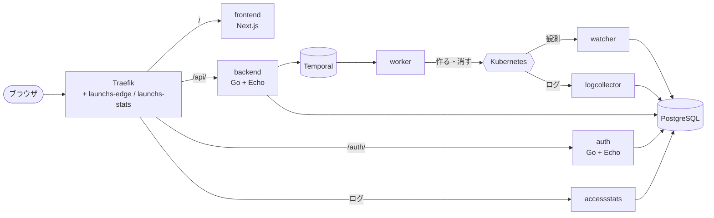

# launchs

コンテナを、Kubernetes の上に、**プロジェクト単位で**デプロイ・公開・運用するための、管理基盤(バックエンド + フロントエンド)。Railway のように、画面でプロジェクトを作り、イメージ、ポート、ボリューム、設定ファイル、公開 URL を、組み合わせて動かす。

## できること
- **プロジェクト**: 1 つが、1 つの Kubernetes の namespace(NetworkPolicy で、他のプロジェクトから隔離)。
- **deploy**: イメージ、スペック(small / medium / large)、環境変数、レプリカ数、起動コマンド、ファイルを指定して動かす。変更は、まず**未適用(pending)**で保存し、確認してから**適用**する。
- **service / ingress**: ポートを公開し、ingress(Traefik の IngressRoute)に、`形容詞-色-動物.<ベースドメイン>` のホスト名を自動で払い出す。
- **volume / ConfigMap**: PVC と、版つきの設定ファイルの組(1 MiB まで。テキストと base64)を、deploy にマウントする。
- **テンプレート**: nginx、PostgreSQL、MariaDB、Redis、code-server、WordPress などを、変数を埋めるだけで、まとめて作る(フォルダ形式の定義。`templates/`)。
- **ログ・イベント・状態**: コンテナの出力ログ、k8s の Event、Pod の実際の状態を、画面で見る。
- **アクセスログ**: ingress ごとに、1 リクエストずつ(日時、メソッド、URL、ステータス、IP、時間)を、表で見て、絞り込める。本当のクライアント IP も、アプリに届く(Traefik のプラグイン)。
- **アカウント**: ユーザー登録とログイン(Cloudflare Turnstile に対応)、管理者、BAN、招待、アカウントごとの上限(クォータ)。

## 構成

- **backend** は、リクエストを受けて、DB に**未適用の値**を保存する。k8s に触れる処理は、**Temporal の Workflow** に任せて、**worker** が実行する。結果が確定してから、正式な値と状態を更新する(pending → apply / discard)。
- **k8s の実際の状態を DB に書くのは、watcher だけ**。ログは logcollector、アクセスログは accessstats だけが書く(いずれも、同時に動くのは 1 つ。PostgreSQL の advisory lock)。
- **auth** は、別のコンテナ。access token は EdDSA で署名し、backend は、JWKS の公開鍵で検証する。

## ディレクトリ
```
backend/        API(Go + Echo + Gorm)
worker/         Temporal のワーカー(k8s を操作)
watcher/        Pod と Deployment を観測して DB に反映
logcollector/   deploy のコンテナのログを保存
accessstats/    Traefik のログから、ingress のアクセスログを保存
auth/           認証(登録・ログイン・トークン・JWKS)
frontend/       フロントエンド(Next.js + React + TypeScript)
shared/         共有のコード(モデル、リポジトリ、Workflow の型、テンプレートのエンジンなど)
templates/      同梱のテンプレート(1 つが 1 フォルダ)
traefik-plugins/  Traefik のプラグイン(launchs-edge、launchs-stats)と、Yaegi での試験
migrations/     DB のマイグレーション(app と auth。up のみ)
deploy/         本番向けの Kubernetes のマニフェスト(kustomize)
docs/           設計、エンドポイントの仕様、コーディング規約
```

## 開発環境
開発は、全て**コンテナの中**で行う(Podman か Docker。コマンドは [Task](https://taskfile.dev) にまとめてある)。

```sh
cp .env.example .env     # 必要なら編集する(各項目の説明が、ファイルの中にある)
task up                  # 開発環境を起動(PostgreSQL、Temporal、auth、backend、frontend、nginx など)
task migrate             # マイグレーションを流す
task admin:create -- alice   # 最初の管理者を作る
```
ブラウザで `https://127.0.0.1:18443` を開く(自己署名の証明書。ポートとアドレスは、`.env` の `HTTPS_HOST_PORT`、`HTTPS_BIND_ADDRESS`)。

| コマンド | 内容 |
|---|---|
| `task up:k8s` | worker、watcher、logcollector、accessstats を、実際の k8s につなぐ(`~/.kube/config`。**namespace を実際に作る・削除する**) |
| `task test` | 全ての Go のテスト |
| `task vet` / `task fmt` | 静的解析 / 整形 |
| `task frontend:test` | フロントエンドの型の検査 |
| `task frontend:build` | フロントエンドの本番用のイメージ |
| `task reset` | 停止して、DB のデータも消す |

k8s につながない既定の状態でも、API と画面は動く(k8s を操作する部分は、何もしない)。k8s に関わる変更は、実際のクラスターでも確認すること。

## 本番
- イメージは、`main` に push されると、GitHub Actions が、テストを通したあと、GHCR(`ghcr.io/launchs-org/v2/<名前>`)に push する(タグは `sha-<短い SHA>` と `latest`)。
- Kubernetes へは、[`deploy/`](deploy/README.md) の kustomize で入れる(`cd deploy && kubectl apply -k .`)。
- Traefik のプラグインの導入は、[docs/ingress-plugins.md](docs/ingress-plugins.md)。

## ドキュメント
- [docs/endpoints/](docs/endpoints/README.md) — **エンドポイントの仕様**(実装の正本)
- [docs/coding-conventions.md](docs/coding-conventions.md) — コードの書き方、ファイルのルール
- [docs/call-flow.md](docs/call-flow.md) — リクエストの流れ、どこで何を組み立てるか
- 機能ごとの設計: [認証](docs/auth.md)、[watcher](docs/watcher.md)、[ログ](docs/logs.md)、[イベント](docs/project-events.md)、[ingress](docs/ingress.md)、[Traefik プラグインとアクセスログ](docs/ingress-plugins.md)、[volume](docs/volume.md)、[ConfigMap](docs/configmap.md)、[テンプレート](docs/templates.md)、[ネットワークの隔離](docs/network-isolation.md)、[フロントエンド](docs/frontend.md)
- [docs/talks/](docs/talks/README.md) — 設計判断の記録(なぜそう決めたか)

## 開発のルール
- ブランチは `develop` から `feature/<短い説明>` を切り、プルリクエストで `develop` に入れる。
- マイグレーションは、up だけ書く。
- コードは、一文字の変数名を使わず、全ての関数に日本語のコメントを書く(詳細は [docs/coding-conventions.md](docs/coding-conventions.md))。
- AI アシスタント向けの案内は、[CLAUDE.md](CLAUDE.md)。
